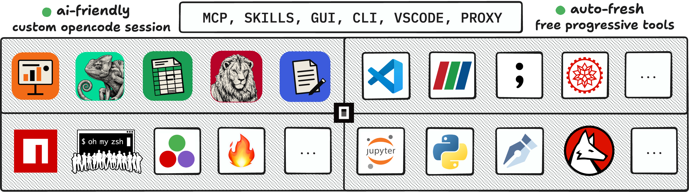

<p align="center">
  
</p>

<h1 align="center">Stack</h1>

<p align="center">
  A local OpenCode stack for a macOS machine: research, math, rendering and office tools — installed, wired into projects and driven by the AI agent.<br>
  <b><code>AGENTS.md</code> — instructions for the agent</b> · <b><code>STACK.md</code> — manual for the user</b>
</p>

---

## Constructor

Four steps. The rest the agent does with you, in chat.

**1. Install OpenCode**

```bash
brew install anomalyco/tap/opencode-v2
```

**2. Clone the stack anywhere**

```bash
git clone https://github.com/custom-opencode/stack.git <path>
```

**3. Start OpenCode from the stack folder**

```bash
cd <path>
opencode
```

**4. Write the first message in chat**

```
Set up the stack
```

That's it. Even on a fresh clone the committed `AGENTS.md` is a bootstrap that tells the agent exactly what to do: read `AGENTS.template.md`, ask you for the personal data first (proxy — in any format you have, git identity, Wolfram ID — each optional, and it warns what stops working if you decline), then run the installation so the downloads already go through your proxy, fill the form, verify every component and attach your project folders (`bash scripts/new-project.sh <any-folder>` — any folder, any depth, git not required). When it finishes, every row of its health check is ✅ — restart OpenCode in your project folder and work.

You only ever do what only a human can do: type answers, click links, confirm in the browser.

## Destructor

```bash
bash scripts/teardown.sh [--deep] [--dry]
```

Removes everything the stack installed or changed:

- detaches the stack from all projects (project-scoped MCP configs and skills go with them — none of it is global)
- cleans files it wrote: `.zshrc` proxy block, `~/.stack-secrets.sh`, `~/.stack-wolfram.conf`, Firecrawl state
- removes generated artifacts: venvs, cloned MCP repos, `craft-cli`, skills-store
- with `--deep`: brew packages the stack added (identified against `.brew-pre-manifest.txt` — a snapshot of what existed before installation), npm CLIs, VS Code extensions, Craft Apps GUI

**Never touched:** OpenCode itself, the stack git repo, Wolfram license data, and anything the user had before installation.

Run with `--dry` first to audit every action without executing anything.
