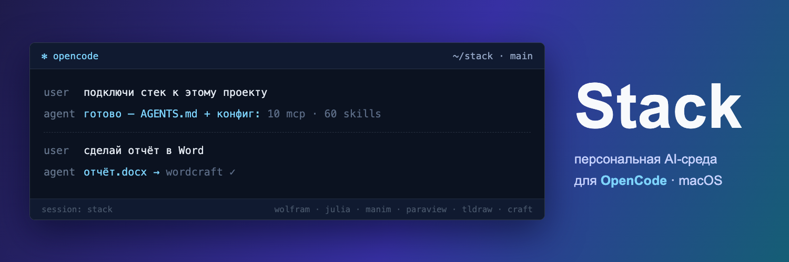

<div align="center">



# Stack

**Персональная AI-разработка среда для macOS: человек + ИИ-ассистент в [OpenCode](https://opencode.ai).**
MCP-серверы, скиллы, CLI-инструменты и офисные приложения — всё подключается к проекту одной командой и обновляется одной командой.

**Язык / Language:** 🇷🇺 Русский (здесь) · [🌍 Все языки — переключение без перехода](#-языки)


> 🤖 **ИИ-агенту:** начать с [`AGENTS.md`](AGENTS.md) — карта репозитория и конвенции.
>
> 👤 **Человеку:** [`STACK.md`](STACK.md) — полная документация: хоткеи, примеры, ссылки.
>
> 🤝 **ИИ + человеку:** [`workflow.txt`](workflow.txt) — правила git-workflow · [`CONTRIBUTING.md`](CONTRIBUTING.md) — как предлагать изменения.

</div>

---

## 🌍 Языки (in-place)

<details>
<summary><b>🇬🇧 English</b></summary>

**Personal AI development environment for macOS: human + AI assistant in [OpenCode](https://opencode.ai).**
MCP servers, skills, CLI tools and office apps — one command to attach to a project, one command to update.

### Why

Research and development need many things at once: computation, data visualization, web research, deliverables in familiar office formats, UI mockups — **in one place, driven by an AI agent**. The stack assembles official open-source tools and attaches them to OpenCode through every available channel: MCP servers, skills, headless CLIs and control scripts — available **only in projects where it is explicitly attached**.

### Principles
Project-scoped · Single source of truth · `update-all.sh` freshness + expiry tracking · Portability (`{env:HOME}`) · Network routing (`proxy.sh`)

### Quick start

```bash
git clone https://github.com/EgoruZz/stack.git ~/stack
cd ~/stack && bash setup.sh     # 12 steps; GUI apps via official brew casks
cp first-start.template.txt first-start.txt   # fill in; then:
bash apply-first-start.sh
```

### Manual steps
- **Wolfram activation** — `wolframscript`, sign in with a Wolfram ID (renew every ~40 days)
- **Firecrawl auth** *(optional)* — `firecrawl login --browser` (an account is required; the free tier is enough)

### Contents
**13 CLI tools** (setup, update-all, check-all, new-project, sync-agents, gen-opencode-config, sync-aris, consolidate-skills, craft-install, apply-first-start, proxy.sh, chrome-version, check-wolfram-license) · **10 MCP servers** (Wolfram, julia, manim, ParaView, tldraw, wordcraft, gridcraft, deckcraft, pdfcraft, figcraft) · **5 Craft Apps** ([ArtCraft](https://getartcraft.com), alpha — keep backups) · **60 skills** · **6 VS Code extensions**

### Attach to a project

```bash
~/stack/new-project.sh ~/work/my-project
```
Receives `AGENTS.md` + `.opencode/opencode.json` (10 MCP + skills). Manual config edits are overwritten on sync — edit the template in `gen-opencode-config.sh`.

### Usage
`update-all.sh` — update everything · `check-all.sh` — health check · `proxy.sh status/test` — network · `proxy.sh expiry` / `check-wolfram-license.sh` — expiry tracking · `firecrawl credits` — quota.

Full agent instructions: [`AGENTS.md`](AGENTS.md) · Full human docs (Russian): [`STACK.md`](STACK.md) · Git rules: [`workflow.txt`](workflow.txt) · Contributing: [`CONTRIBUTING.md`](CONTRIBUTING.md).
</details>

<details>
<summary><b>🇯🇵 日本語</b></summary>

**macOS 向けパーソナルAI開発環境: ヒト + [OpenCode](https://opencode.ai) の AI アシスタント。**
MCP サーバー、スキル、CLI ツール、オフィスアプリ — プロジェクトへの接続も更新もワンコマンド。

### 概要

リサーチと開発には、計算・データ可視化・ウェブリサーチ・オフィス形式の成果物・UI モックアップが一度に必要です — **すべてを一箇所で、AI エージェントの管理下で**。スタックは公式オープンソースツールを集め、MCP サーバー、スキル、ヘッドレス CLI、管理スクリプトのすべての経路で OpenCode に接続し、**明示的に接続されたプロジェクトでのみ**利用可能にします。

### クイックスタート

```bash
git clone https://github.com/EgoruZz/stack.git ~/stack
cd ~/stack && bash setup.sh     # 12 ステップ; GUI は公式 brew cask で自動インストール
cp first-start.template.txt first-start.txt   # 記入後:
bash apply-first-start.sh
```

### 手動ステップ
- **Wolfram の有効化** — `wolframscript` で Wolfram ID でサインイン(約 40 日ごとに更新)
- **Firecrawl 認証** *(任意)* — `firecrawl login --browser`(アカウントが必要、無料枠で十分)

### 内容
**13 CLI ツール** · **10 MCP サーバー**(Wolfram, julia, manim, ParaView, tldraw, wordcraft, gridcraft, deckcraft, pdfcraft, figcraft) · **5 Craft Apps**([ArtCraft](https://getartcraft.com)、アルファ品質 — 重要ファイルのバックアップを) · **60 スキル** · **6 VS Code 拡張**

### プロジェクトへの接続

```bash
~/stack/new-project.sh ~/work/my-project
```

### 使い方
`update-all.sh` 全更新 · `check-all.sh` 健全性チェック · `proxy.sh status/test` ネットワーク · `proxy.sh expiry` 期限管理 · `firecrawl credits` 残高。

エージェント向け: [`AGENTS.md`](AGENTS.md) · 詳細ドキュメント: [`STACK.md`](STACK.md) · Contributing: [`CONTRIBUTING.md`](CONTRIBUTING.md)。
</details>

<details>
<summary><b>🇨🇳 中文</b></summary>

**macOS 个人 AI 开发环境:人类 + [OpenCode](https://opencode.ai) 的 AI 助手。**
MCP 服务器、技能、CLI 工具和办公应用——连接到项目一条命令,更新全部一条命令。

### 简介

科研与开发需要同时具备:计算、数据可视化、网络调研、常见办公格式的交付文档、界面设计稿——**全部集中在一处,由 AI 智能体驱动**。本技术栈汇集官方开源工具,通过 MCP 服务器、技能、无头 CLI 与管控脚本等所有途径接入 OpenCode,并**仅在明确接入的项目中生效**。

### 快速开始

```bash
git clone https://github.com/EgoruZz/stack.git ~/stack
cd ~/stack && bash setup.sh     # 12 步;GUI 应用通过官方 brew cask 自动安装
cp first-start.template.txt first-start.txt   # 填写后:
bash apply-first-start.sh
```

### 手动步骤
- **Wolfram 激活** — `wolframscript` 使用 Wolfram ID 登录(约每 40 天续期)
- **Firecrawl 认证** *(可选)* — `firecrawl login --browser`(需要账号,免费额度即可)

### 内容
**13 个 CLI 工具** · **10 个 MCP 服务器**(Wolfram, julia, manim, ParaView, tldraw, wordcraft, gridcraft, deckcraft, pdfcraft, figcraft) · **5 个 Craft Apps**([ArtCraft](https://getartcraft.com),alpha 质量——请备份重要文档) · **60 个技能** · **6 个 VS Code 扩展**

### 接入项目

```bash
~/stack/new-project.sh ~/work/my-project
```

### 使用
`update-all.sh` 全量更新 · `check-all.sh` 健康检查 · `proxy.sh status/test` 网络 · `proxy.sh expiry` 期限管理 · `firecrawl credits` 额度。

智能体指南: [`AGENTS.md`](AGENTS.md) · 完整文档: [`STACK.md`](STACK.md) · 贡献指南: [`CONTRIBUTING.md`](CONTRIBUTING.md)。
</details>

<details>
<summary><b>🇰🇷 한국어</b></summary>

**macOS용 개인 AI 개발 환경: 사람 + [OpenCode](https://opencode.ai) AI 어시스턴트.**
MCP 서버, 스킬, CLI 도구, 오피스 앱 — 프로젝트 연결도 업데이트도 한 번의 명령어로.

### 소개

연구와 개발에는 계산, 데이터 시각화, 웹 리서치, 익숙한 오피스 형식의 산출물, UI 목업이 동시에 필요합니다 — **모두 한 곳에서, AI 에이전트의 주도로**. 이 스택은 공식 오픈소스 도구를 모아 MCP 서버, 스킬, 헤드리스 CLI, 관리 스크립트의 모든 경로로 OpenCode에 연결하며, **명시적으로 연결된 프로젝트에서만** 작동합니다.

### 빠른 시작

```bash
git clone https://github.com/EgoruZz/stack.git ~/stack
cd ~/stack && bash setup.sh     # 12 단계; GUI는 공식 brew cask로 자동 설치
cp first-start.template.txt first-start.txt   # 작성 후:
bash apply-first-start.sh
```

### 수동 단계
- **Wolfram 활성화** — `wolframscript`에서 Wolfram ID 로그인(약 40일마다 갱신)
- **Firecrawl 인증** *(선택)* — `firecrawl login --browser`(계정 필요, 무료 티어로 충분)

### 구성
**13개 CLI 도구** · **10개 MCP 서버**(Wolfram, julia, manim, ParaView, tldraw, wordcraft, gridcraft, deckcraft, pdfcraft, figcraft) · **5개 Craft Apps**([ArtCraft](https://getartcraft.com), 알파 품질 — 중요 문서 백업 요망) · **60개 스킬** · **6개 VS Code 확장**

### 프로젝트 연결

```bash
~/stack/new-project.sh ~/work/my-project
```

### 사용법
`update-all.sh` 전체 업데이트 · `check-all.sh` 상태 점검 · `proxy.sh status/test` 네트워크 · `proxy.sh expiry` 만료 관리 · `firecrawl credits` 크레딧.

에이전트 가이드: [`AGENTS.md`](AGENTS.md) · 전체 문서: [`STACK.md`](STACK.md) · 기여: [`CONTRIBUTING.md`](CONTRIBUTING.md).
</details>

<details>
<summary><b>🇩🇪 Deutsch</b></summary>

**Persönliche AI-Entwicklungsumgebung für macOS: Mensch + KI-Assistent in [OpenCode](https://opencode.ai).**
MCP-Server, Skills, CLI-Tools und Office-Apps — ein Befehl zum Anbinden an ein Projekt, ein Befehl zum Aktualisieren.

### Warum

Forschung und Entwicklung brauchen vieles gleichzeitig: Berechnungen, Datenvisualisierung, Web-Recherche, Deliverables in gängigen Office-Formaten, UI-Mockups — **an einem Ort, gelenkt von einem KI-Agenten**. Der Stack versammelt offizielle Open-Source-Tools und bindet sie über alle Kanäle an OpenCode an: MCP-Server, Skills, Headless-CLIs und Kontroll-Skripte — verfügbar **nur in Projekten, wo er explizit angehängt ist**.

### Schnellstart

```bash
git clone https://github.com/EgoruZz/stack.git ~/stack
cd ~/stack && bash setup.sh     # 12 Schritte; GUI-Apps über offizielle brew casks
cp first-start.template.txt first-start.txt   # ausfüllen, dann:
bash apply-first-start.sh
```

### Manuelle Schritte
- **Wolfram-Aktivierung** — `wolframscript`, Anmeldung mit Wolfram ID (Verlängerung alle ~40 Tage)
- **Firecrawl-Auth** *(optional)* — `firecrawl login --browser` (Konto erforderlich; Free-Tier reicht)

### Inhalt
**13 CLI-Tools** · **10 MCP-Server**(Wolfram, julia, manim, ParaView, tldraw, wordcraft, gridcraft, deckcraft, pdfcraft, figcraft) · **5 Craft Apps**([ArtCraft](https://getartcraft.com), Alpha-Qualität — Backups wichtiger Dokumente) · **60 Skills** · **6 VS-Code-Erweiterungen**

### An Projekt anbinden

```bash
~/stack/new-project.sh ~/work/my-project
```

### Verwendung
`update-all.sh` alles aktualisieren · `check-all.sh` Gesundheits-Check · `proxy.sh status/test` Netzwerk · `proxy.sh expiry` Fristen · `firecrawl credits` Kontingent.

Für Agenten: [`AGENTS.md`](AGENTS.md) · Volle Doku: [`STACK.md`](STACK.md) · Git-Regeln: [`workflow.txt`](workflow.txt) · Contributing: [`CONTRIBUTING.md`](CONTRIBUTING.md).
</details>

<details>
<summary><b>🇪🇸 Español</b></summary>

**Entorno personal de desarrollo con IA para macOS: humano + asistente de IA en [OpenCode](https://opencode.ai).**
Servidores MCP, skills, herramientas CLI y apps de oficina — un comando para conectar a un proyecto, un comando para actualizar.

### Por qué

La investigación y el desarrollo requieren muchas cosas a la vez: cálculos, visualización de datos, investigación web, entregables en formatos de oficina, mockups de interfaz — **en un solo lugar, dirigidos por un agente de IA**. El stack reúne herramientas open-source oficiales y las conecta a OpenCode por todos los canales: servidores MCP, skills, CLIs headless y scripts de control — disponibles **solo en los proyectos donde se conecta explícitamente**.

### Inicio rápido

```bash
git clone https://github.com/EgoruZz/stack.git ~/stack
cd ~/stack && bash setup.sh     # 12 pasos; apps GUI vía brew casks oficiales
cp first-start.template.txt first-start.txt   # rellenar, luego:
bash apply-first-start.sh
```

### Pasos manuales
- **Activación Wolfram** — `wolframscript`, iniciar sesión con Wolfram ID (renovar cada ~40 días)
- **Firecrawl auth** *(opcional)* — `firecrawl login --browser` (se requiere cuenta; el tier gratuito basta)

### Contenido
**13 herramientas CLI** · **10 servidores MCP**(Wolfram, julia, manim, ParaView, tldraw, wordcraft, gridcraft, deckcraft, pdfcraft, figcraft) · **5 Craft Apps**([ArtCraft](https://getartcraft.com), calidad alfa — guarda copias de documentos importantes) · **60 skills** · **6 extensiones VS Code**

### Conectar a un proyecto

```bash
~/stack/new-project.sh ~/work/my-project
```

### Uso
`update-all.sh` actualizar todo · `check-all.sh` verificación · `proxy.sh status/test` red · `proxy.sh expiry` vencimientos · `firecrawl credits` cuota.

Para agentes: [`AGENTS.md`](AGENTS.md) · Docs completas: [`STACK.md`](STACK.md) · Contribuir: [`CONTRIBUTING.md`](CONTRIBUTING.md).
</details>

<details>
<summary><b>🇫🇷 Français</b></summary>

**Environnement de développement IA personnel pour macOS : humain + assistant IA dans [OpenCode](https://opencode.ai).**
Serveurs MCP, skills, outils CLI et applications bureautiques — une commande pour connecter à un projet, une commande pour tout mettre à jour.

### Pourquoi

La recherche et le développement exigent beaucoup à la fois : calculs, visualisation de données, recherche web, livrables aux formats bureautiques, maquettes d'interface — **au même endroit, pilotés par un agent IA**. Le stack rassemble des outils open-source officiels et les rattache à OpenCode par tous les canaux : serveurs MCP, skills, CLIs headless et scripts de contrôle — disponibles **uniquement dans les projets où il est explicitement rattaché**.

### Démarrage rapide

```bash
git clone https://github.com/EgoruZz/stack.git ~/stack
cd ~/stack && bash setup.sh     # 12 étapes ; apps GUI via brew casks officiels
cp first-start.template.txt first-start.txt   # remplir, puis :
bash apply-first-start.sh
```

### Étapes manuelles
- **Activation Wolfram** — `wolframscript`, connexion avec un Wolfram ID (renouveler tous les ~40 jours)
- **Firecrawl auth** *(optionnel)* — `firecrawl login --browser` (un compte est requis ; le tier gratuit suffit)

### Contenu
**13 outils CLI** · **10 serveurs MCP**(Wolfram, julia, manim, ParaView, tldraw, wordcraft, gridcraft, deckcraft, pdfcraft, figcraft) · **5 Craft Apps**([ArtCraft](https://getartcraft.com), qualité alpha — gardez des copies des documents importants) · **60 skills** · **6 extensions VS Code**

### Rattacher à un projet

```bash
~/stack/new-project.sh ~/work/my-project
```

### Utilisation
`update-all.sh` tout mettre à jour · `check-all.sh` vérification · `proxy.sh status/test` réseau · `proxy.sh expiry` échéances · `firecrawl credits` quota.

Pour les agents : [`AGENTS.md`](AGENTS.md) · Docs complètes : [`STACK.md`](STACK.md) · Contribuer : [`CONTRIBUTING.md`](CONTRIBUTING.md).
</details>

<details>
<summary><b>🇧🇷 Português</b></summary>

**Ambiente pessoal de desenvolvimento com IA para macOS: humano + assistente de IA no [OpenCode](https://opencode.ai).**
Servidores MCP, skills, ferramentas CLI e apps de escritório — um comando para conectar a um projeto, um comando para atualizar.

### Por quê

Pesquisa e desenvolvimento exigem muitas coisas ao mesmo tempo: cálculos, visualização de dados, pesquisa web, entregáveis em formatos de escritório, mockups de interface — **em um só lugar, conduzidos por um agente de IA**. O stack reúne ferramentas open-source oficiais e as conecta ao OpenCode por todos os canais: servidores MCP, skills, CLIs headless e scripts de controle — disponíveis **apenas nos projetos onde é explicitamente anexado**.

### Início rápido

```bash
git clone https://github.com/EgoruZz/stack.git ~/stack
cd ~/stack && bash setup.sh     # 12 etapas; apps GUI via brew casks oficiais
cp first-start.template.txt first-start.txt   # preencher, depois:
bash apply-first-start.sh
```

### Passos manuais
- **Ativação do Wolfram** — `wolframscript`, login com Wolfram ID (renovar a cada ~40 dias)
- **Firecrawl auth** *(opcional)* — `firecrawl login --browser` (uma conta é necessária; o tier gratuito basta)

### Conteúdo
**13 ferramentas CLI** · **10 servidores MCP**(Wolfram, julia, manim, ParaView, tldraw, wordcraft, gridcraft, deckcraft, pdfcraft, figcraft) · **5 Craft Apps**([ArtCraft](https://getartcraft.com), qualidade alfa — guarde cópias dos documentos importantes) · **60 skills** · **6 extensões VS Code**

### Anexar a um projeto

```bash
~/stack/new-project.sh ~/work/my-project
```

### Uso
`update-all.sh` atualizar tudo · `check-all.sh` verificação · `proxy.sh status/test` rede · `proxy.sh expiry` vencimentos · `firecrawl credits` créditos.

Para agentes: [`AGENTS.md`](AGENTS.md) · Docs completas: [`STACK.md`](STACK.md) · Contribuir: [`CONTRIBUTING.md`](CONTRIBUTING.md).
</details>


---

<h2 align="center">🧠 Зачем</h2>

Research и разработка требуют многого сразу: вычислений, визуализации данных, веб-исследований, документов-деливераблов в привычных офисных форматах, интерфейсных мокапов — **в одном месте и под управлением ИИ-агента**. Стек собирает официальные open-source инструменты и подключает их к OpenCode всеми возможными каналами: **MCP-серверы** (интерактивные вычисления и редактирование), **скиллы** (пошаговые workflow для агента), **headless-CLI** (скриптовое применение команд без окна) и **CLI-скрипты контроля** (проверки, обновления, срок-контроль) — и делает всё это доступным **только в проектах, где он явно включён**: глобальный конфиг OpenCode остаётся пустым, вне проектов агент их не видит.

| Принцип | Что значит |
|---------|-----------|
| **Проектность** | Стек поднимается только в проектах, где подключён |
| **Один источник** | Шаблон конфига, списки скиллов, карта репозитория правятся в одном месте и расходятся скриптами |
| **Свежесть** | `update-all.sh` обновляет всё: brew → репо → venv → скиллы → Julia → Wolfram → Craft Apps, и следит за сроками лицензий/подписок |
| **Переносимость** | Пути в конфигах через `{env:HOME}`; свежая машина = `git clone` + `setup.sh` |
| **Маршрутизация** | Локальный трафик стека — всегда напрямую; внешний web — через настроенный ISP-прокси (`proxy.sh`, персональные значения в `~/.stack-secrets.sh`) |

## Оглавление

- [📁 Структура репозитория](#-структура-репозитория)
- [🖐 Ручные шаги](#-ручные-шаги)
- [🚀 Быстрый старт](#-быстрый-старт)
- [📦 Что внутри](#-что-внутри)
- [🔌 Стек в проекте](#-стек-в-проекте)
- [🤝 Файлы: человек vs ИИ-агент](#-файлы-человек-vs-ии-агент)
- [🛠 Использование](#-использование)

<h2 align="center">🗺️ Структура репозитория</h2>

Все `*.sh` — CLI-инструменты (запуск: `bash ~/stack/<имя>.sh`):

```
~/stack/
├── README.md                    # Этот файл
├── AGENTS.md                    # Инструкции агента (с картой репозитория)
├── STACK.md                     # Полная документация: хоткеи, примеры
├── workflow.txt                 # Правила git-workflow
│
├── setup.sh                     # Установка на чистую macOS (12 шагов)
├── update-all.sh                # Обновление всего (13 шагов) + срок-контроль
├── check-all.sh                 # Проверка работоспособности
│
├── new-project.sh               # Подключить проект
├── sync-agents.sh               # AGENTS.md + конфиги → все проекты
├── gen-opencode-config.sh       # Генератор .opencode/opencode.json (10 MCP)
├── sync-aris.sh                 # ARIS-скиллы → skills-store
├── consolidate-skills.sh        # Сборка skills-store + чистка глобальных
├── craft-install.sh             # Установка/обновление Craft Apps (GUI)
├── apply-first-start.sh         # Форма первого старта → личные конфиги
├── proxy.sh                     # Сеть: env-прокси + CLI (status/expiry/git/test)
├── chrome-version.sh            # Версия Chrome под пин tldraw
├── check-wolfram-license.sh     # Срок лицензии Wolfram
│
├── first-start.template.txt     # Шаблон формы первого старта
├── projects.txt                 # Реестр проектов
├── aris-skills.txt              # Список 14 ARIS-скиллов
├── skills/                      # 8 standalone-скиллов (источник)
├── skills-store/                # Собранные 60 скиллов (gitignored)
├── craft-cli/                   # Headless-CLI Craft Apps (gitignored)
├── craft-downloads/             # Кэш DMG установщиков (gitignored)
├── WolframLanguage/             # Пользовательские Wolfram-пакеты
│
└── paraview-mcp/ · manim-mcp/ · julia-mcp/ · tldraw-mcp/ ·      # клонированные
    aris-research-repo/ · WolframLanguageForJupyter/             # репозитории
```

<h2 align="center">🖐 Ручные шаги</h2>

brew-каски ставят почти всё автоматически — включая то, что раньше было ручным (OpenCode, Wolfram Engine, ParaView, MacTeX, tldraw Desktop). Руками остаётся только:

| Шаг | Зачем | Как |
|-----|-------|-----|
| **Форма первого старта** | прокси, Wolfram ID, git identity | `cp ~/stack/first-start.template.txt ~/stack/first-start.txt` → заполнить → `bash ~/stack/apply-first-start.sh` |
| **Активация Wolfram** | лицензия MCP (продлевать каждые ~40 дней) | `wolframscript` — войти с Wolfram ID; проверка: `bash ~/stack/check-wolfram-license.sh` |
| **Firecrawl auth** *(опционально)* | Firecrawl работает по учётной записи: без входа доступен лишь минимальный анонимный лимит, с бесплатным аккаунтом — полноценный лимит | `firecrawl login --browser`; проверка: `firecrawl --status` |

> Наличие компонентов проверяет `check-all.sh` — по каждому ✅ или ❌.

<h2 align="center">🚀 Быстрый старт</h2>

```bash
git clone https://github.com/EgoruZz/stack.git ~/stack
cd ~/stack
bash setup.sh        # 12 шагов: brew+каски, репозитории, venv, CLI, скиллы, конфиги
```

- Пароль спрашивается только там, где его требует система
- В конце запускается автопроверка — все компоненты должны быть ✅
- Форма первого старта применяется автоматически, если `first-start.txt` заполнен
- Проекты подключаются: `~/stack/new-project.sh <путь>`

<h2 align="center">📦 Что внутри</h2>

### Терминальные и CLI-инструменты

Всё ставится автоматически `setup.sh`:

| Что | Как ставится |
|-----|--------------|
| Python 3.12 · Node.js · gh · ffmpeg · juliaup | `brew install` |
| Wolfram Engine · ParaView · MacTeX · tldraw Desktop | `brew install --cask` |
| OpenCode | `brew install anomalyco/tap/opencode-v2` |
| `firecrawl-cli` · `tldraw-cli` | `npm install -g` |
| `manim-env` — Manim + ManimGL | pip venv |
| `jupyter-env` — JupyterLab, numpy, pandas, sympy, plotly… | pip venv |
| `paraview-mcp-env`, `julia-mcp-env` — MCP SDK | pip venv |
| Playwright Chromium · Puppeteer Chrome *(headless, версия авто)* | `npx … install` |
| Julia + 20 пакетов | `juliaup` + `Pkg.add` |
| Wolfram AgentTools (paclet) | `PacletInstall` — если Wolfram Engine уже установлен, иначе при первом `update-all.sh` |
| 6 внешних репозиториев | `git clone --depth 1` |
| сборка `tldraw-mcp` | `npm install && npm run build` |
| Headless-CLI Craft Apps ×5 | GitHub releases → `~/stack/craft-cli/` |

> **Manim vs ManimGL:** `manim` (community) — рендерит headless, его использует MCP-сервер. `manimgl` (3Blue1Brown) — интерактивный GUI-инструмент, ни один MCP его не использует.

### MCP-серверы (10)

Конфиги генерируются автоматически (`gen-opencode-config.sh`); для ParaView запусти GUI + pvserver по workflow из `STACK.md`:

| Сервер | Что делает |
|--------|-----------|
| **Wolfram** | Вычисления на Wolfram Language (AgentTools) |
| **julia** | Persistent Julia REPL-сессии |
| **manim** | Headless-рендер анимаций в видео |
| **ParaView** | 3D-визуализация данных (через TCP-мост) |
| **tldraw** | Whiteboard-холст, 30+ инструментов |
| **wordcraft** | Word-документы: .docx, цитирования APA/MLA/Chicago/IEEE, Zotero |
| **gridcraft** | Excel: .xlsx, 500+ функций, PivotTables, графики |
| **deckcraft** | PowerPoint: .pptx, темы, Morph, экспорт PDF/GIF |
| **pdfcraft** | PDF: объединение, разделение, защита, комментарии |
| **figcraft** | UI-дизайн: frames, auto-layout, прототипы |

### Craft Apps (5)

Нативные macOS-приложения [ArtCraft](https://getartcraft.com) (open source, pure Rust) — у каждого есть headless-CLI и MCP. GUI ставится/обновляется скриптом:

```bash
bash ~/stack/craft-install.sh
```

| Приложение | Статус (официально) |
|---|---|
| WordCraft · GridCraft · DeckCraft | In development |
| PdfCraft · FigCraft | Early alpha |

> ⚠️ Все приложения — предрелизные: сложные файлы из MS Office и .fig-файлы открываются best-effort и могут отображаться не идеально — **храни копии важных документов**.

### Расширения VS Code (6)

Ставятся автоматически `setup.sh`, если установлен VS Code CLI (`code`): `tldraw-org.tldraw-vscode` (.tldr), `ms-python.python` (.py), `ms-toolsai.jupyter` (.ipynb), `julialang.language-julia` (.jl), `wolframresearch.wolfram` (.wl), `james-yu.latex-workshop` (.tex).

### Скиллы OpenCode (60)

Собираются автоматически (`consolidate-skills.sh`) в `~/stack/skills-store/` и подключаются к проектам через `skills` в конфиге — **вне проектов агент видит только встроенные скиллы OpenCode**.

| Группа | ~Кол-во | Источник |
|--------|---------|----------|
| Firecrawl — веб-research, скрапинг, SEO | 37 | `firecrawl setup skills/build/workflows` |
| ARIS — research pipeline, статьи, эксперименты | 14 | клон ARIS → `sync-aris.sh` |
| `tldraw-offline` — управление открытым tldraw Desktop | 1 | ставит само приложение |
| Standalone — см. `skills/` репозитория | 8 | этот репозиторий |

<details>
<summary><b>8 standalone-скиллов поимённо</b></summary>

| Скилл | Назначение |
|-------|-----------|
| `render-visual` | Полированные PNG/SVG/PDF, слайды, схемы, GIF |
| `data-analysis` | EDA, визуализация данных, отчёты, гипотезы |
| `craft-office` | Office-деливераблы: Word/Excel/PowerPoint/PDF через Craft Apps |
| `deep-mind` | Глубокое критическое мышление |
| `epistemic-rigor` | Anti-sycophancy, честная оценка гипотез |
| `grill-me` | Стресс-тест планов и решений |
| `dag-hallucination-detector` | Проверка цитат и фактов |
| `aris-research-pipeline` | Полный research pipeline (local-only) |

</details>

<h2 align="center">🔌 Стек в проекте</h2>

```bash
~/stack/new-project.sh ~/work/my-project    # создать новый / зарегистрировать существующий
```

Проект получает **два файла**:

| Файл | Содержимое |
|------|-----------|
| `AGENTS.md` | Инструкции агента: карта стека, MCP-инструменты, конвенции |
| `.opencode/opencode.json` | `mcp` ×10 · `skills` → skills-store |

| Факт | Детали |
|------|--------|
| **Переносимость** | Пути в конфиге через `{env:HOME}` — переносим между машинами |
| **Реестр проектов** | `~/stack/projects.txt` — по одному пути на строку |
| **Синхронизация** | `bash ~/stack/sync-agents.sh` перегенерирует AGENTS.md + конфиги во всех проектах; контент AGENTS.md вне маркеров `<!-- STACK:START/END -->` сохраняется |
| **Конфиг — без маркеров** | `.opencode/opencode.json` перегенерируется **целиком**: правь шаблон в `gen-opencode-config.sh`, не конфиги проектов |
| **Диагностика — через запуск** | OpenCode v2 не имеет LSP: агент получает ошибки, запуская линтеры/компиляторы/тесты напрямую |
| **Вне проектов** | Ни MCP, ни скиллов; в `~/.config/opencode/` только клиентские настройки |
| **Расширения — без плагинов** | Все расширения через MCP (внешние процессы) и скиллы (промпты); конфиг не содержит поля `plugins` |

<h2 align="center">🤝 Файлы: человек vs ИИ-агент</h2>

Ты — в VS Code (расширения стека дают языковые серверы: автодополнение и ошибки при печати), агент — в OpenCode (через MCP/CLI и запуск компиляторов/линтеров напрямую):

| Файл | Человек — в VS Code | Агент — в OpenCode |
|------|---------------------|--------------------|
| `.tldr` | Рисуешь на холсте | tldraw MCP; рендер `tldraw export` |
| `.py` | Pylance | Запуск кода; линтеры |
| `.sh` | Терминал: `bash -n` | `bash -n` + запуск |
| `.jl` | Julia LS | Запуск `julia` |
| `.ts` | Встроенный TS | `npm run build` |
| `.ipynb` | Ячейки в GUI | `jupyter` |
| `.tex` | Компиляция + PDF | `pdflatex` + чтение лога |
| `.wl` | Подсветка + wolframscript | wolframscript |
| `.docx` `.xlsx` `.pptx` `.pdf` | Craft Apps GUI | Craft Apps MCP/CLI (headless или live-режим) |
| `.figcraft` | FigCraft | FigCraft MCP/CLI: frames, прототипы, экспорт PNG/SVG/PDF |

<h2 align="center">🛠 Использование</h2>

| Задача | Команда |
|--------|---------|
| **Обновить весь стек** | `cd ~/stack && bash update-all.sh` — 13 шагов, затем `/reload` или перезапуск OpenCode |
| **Проверить работоспособность** | `bash ~/stack/check-all.sh` |
| **Подключить проект** | `~/stack/new-project.sh <путь>` |
| **Синхронизировать проекты** | `bash ~/stack/sync-agents.sh` |
| **Установить/обновить Craft Apps** | `bash ~/stack/craft-install.sh` |
| **Сеть: статус / тест / git** | `bash ~/stack/proxy.sh status` · `test` · `git on\|off` |
| **Сроки: прокси / Wolfram** | `bash ~/stack/proxy.sh expiry` · `bash ~/stack/check-wolfram-license.sh` |
| **Кредиты Firecrawl** | `firecrawl credits` |
| **Версия Chrome под tldraw** | `bash ~/stack/chrome-version.sh` |

> Конфиги OpenCode v2 перечитываются на лету (`/reload`); после обновления самих компонентов (бинарники MCP, venv, скиллы) надёжнее перезапустить OpenCode.
